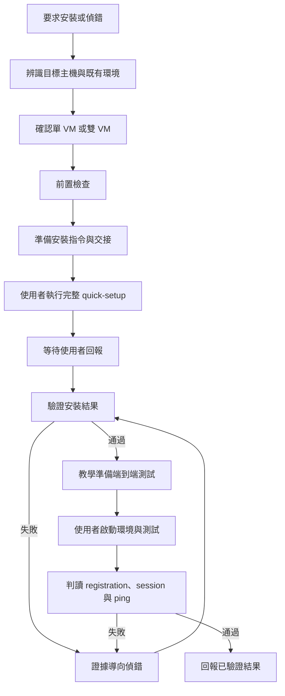

# free5gc-deploy：Codex 實作規格

本文件可直接交給 Codex，作為建立 `free5gc/agent-skills` repository 中 `free5gc-deploy` skill 的實作指示。請完成檔案、唯讀檢查腳本、驗證與交付說明；不要只提供設計建議，也不要在開發主機實際執行 free5GC 安裝。

## 1. 目標與使用情境

讓新手安裝 skill 後，向 Claude Code、GitHub Copilot 或 Codex 說「幫我安裝 free5GC」，agent 就能：

1. 確認目標 Ubuntu 主機與測試拓樸，收集環境並判斷安裝前提。
2. 查閱官方資料，準備符合實際環境的安裝指令。
3. 引導使用者自行執行完整的官方 `quick-setup.sh`。
4. 在使用者回覆結果後接續驗證，遇到問題以證據進行診斷。
5. 教使用者建立 subscriber、準備 free-ran-ue，在不同 terminal 啟動環境，並透過 UE tunnel ping DN 測試目標。
6. 清楚區分安裝完成、核心網路啟動與端到端通過，不將未測試項目當作成功。

發佈後，使用者應能執行：

```bash
npx skills add free5gc/agent-skills --skill free5gc-deploy
```

跨專案使用的選項：

```bash
npx skills add free5gc/agent-skills --skill free5gc-deploy -g
```

這是安裝 skill 的指令，不會安裝 free5GC。以 GitHub repo 發佈即可，不需要另外發佈自己的 npm package。核心 skill 使用通用格式；不同 agent 的發現、觸發與工具行為需要個別驗證，不承諾安裝後一定自動觸發。

## 2. 範圍與技術選擇

- 支援 Ubuntu 上以官方 quick setup 安裝 free5GC。
- 端到端測試支援兩種拓樸：單 VM + network namespace、雙 VM。
- 第一版使用 free-ran-ue 作為 RAN／UE simulator。
- skill 核心以英文撰寫，方便開源與跨 agent 使用；agent 對話依使用者語言回覆，新手教學要具體。
- 使用 Markdown + YAML frontmatter、按需載入的 references、少量唯讀 Bash 腳本與 Git。
- 不建立另一套 installer、不拆開重組 quick-setup、不引入 LangChain、LangGraph、向量資料庫或常駐 MCP server。
- 不假設具有 sudo、SSH、網頁操作或特定 connector；根據現有工具選擇直接檢查或使用者交接。
- 本實作任務不授權實際安裝套件、修改開發主機網路、停用防火牆、建立 namespace 或啟動核心網路。
- 在指定工作目錄或既有 repo 實作，先讀適用的 AGENTS.md，保留使用者既有修改。若沒有 repo，可建立本地專案；不要自行建立遠端 repository、push 或發佈。完成本地可 review 的變更後回報發佈所需步驟。

## 3. 官方知識來源

實作前讀取以下來源，記錄實際查核日期與相應版本。不要把本文件中的描述當成永遠有效的產品規格。

| 來源 | 用途 |
| --- | --- |
| https://free5gc.org/guide/quick-setup/ | 前置條件、完整 source 指令、啟動方法 |
| https://github.com/free5gc/free5gc/blob/main/quick-setup.sh | 安裝行為、參數、互動與系統變更 |
| https://free5gc.org/guide/ | 配置、手動安裝、subscriber、N6 NAT、troubleshooting 索引 |
| https://free-ran-ue.github.io/doc-user-guide/ | simulator 部署方式索引 |
| https://free-ran-ue.github.io/doc-user-guide/01-free5gc/ | 核心網路整合與 subscriber 入口 |
| https://free-ran-ue.github.io/doc-user-guide/02-free-ran-ue/ | build、gNB／UE、UE tunnel 與 ICMP 測試 |
| https://free-ran-ue.github.io/doc-user-guide/03-namespace-free-ran-ue/ | 單 VM namespace 拓樸、建立與清理方法 |
| https://github.com/free-ran-ue/free-ran-ue | simulator 對應版本的 YAML、Makefile 與實際執行需求 |
| https://github.com/vercel-labs/skills | CLI discovery、安裝與 agent 支援 |

從官方索引進一步查閱需要的頁面，尤其 subscriber 欄位、N6 NAT 與 troubleshooting。資料衝突時以使用者實際版本、原始碼與觀測結果釐清，說明差異；不要照抄錯誤欄位、舊版規則或把 GTP-U 綁定位址誤稱為 N6 出口。

本地 references 保存整理過的操作與診斷知識，並附來源；sources.md 保存入口與版本資訊。網路不可用時仍可執行本地檢查，但標示未確認的版本資訊，不虛構已查閱內容。

## 4. Repository 結構

以下為檔案清單，所有 skill 內部資源必須放在同一個 skill 目錄，並透過相對路徑引用。不可硬編碼使用者的 skill 安裝位置。

| 路徑 | 工作 |
| --- | --- |
| README.md | 人類閱讀的安裝指令、範圍與簡短使用範例 |
| LICENSE | 先確認 repo 既有授權政策；若無授權，不擅自選擇，列為發佈前待確認項目 |
| skills/free5gc-deploy/SKILL.md | 主流程、觸發條件、交接規則、references 導航與完成條件 |
| skills/free5gc-deploy/references/sources.md | 官方來源索引、主題對應、版本與查核資訊 |
| skills/free5gc-deploy/references/preflight.md | 前置檢查與判斷規則 |
| skills/free5gc-deploy/references/installation.md | 版本辨識、介面選擇、完整安裝指令、互動與接續 |
| skills/free5gc-deploy/references/troubleshooting.md | 依失敗階段整理診斷流程 |
| skills/free5gc-deploy/references/verification.md | 各層級成功、失敗與未知的證據標準 |
| skills/free5gc-deploy/references/end-to-end-test.md | 單／雙 VM 分支、subscriber、free-ran-ue、各 terminal 操作與 DN 測試 |
| skills/free5gc-deploy/scripts/collect-env.sh | 唯讀環境資料收集 |
| skills/free5gc-deploy/scripts/check-install.sh | 唯讀安裝結果檢查 |
| tests/ | 腳本 fixtures、mock commands 與 skill 情境檢查材料 |

README.md 是 repository 的公開入口，不要再在 skill 內堆疊重複的 README 或額外入門手冊。agents/openai.yaml 若有實際需要再加入；核心流程不依賴它。

SKILL.md frontmatter 至少包含：

```yaml
---
name: free5gc-deploy
description: Guide users through official free5GC quick setup on Ubuntu, verify installation, troubleshoot failures, and guide free-ran-ue connectivity tests with either single-VM namespace isolation or two VMs. Use when users ask to install, deploy, validate, or troubleshoot this setup.
---
```

## 5. 執行流程



修復後應重新驗證原本失敗的階段；上圖簡化了返回位置，不要求每次重做所有檢查。使用者直接要求偵錯時，從既有狀態與失敗階段開始，不強迫重新安裝。

## 6. 每份 reference 的具體要求

### 6.1 preflight.md

解決「目標或環境不符合，仍開始修改系統」的問題。

先確認 agent 所在主機與 free5GC 目標主機是否相同。macOS／Windows 上的 agent 不代表 Linux 指令應在本機執行；有已授權的遠端工具才使用，否則提供目標主機指令並收集輸出。

在選擇介面之前，詢問尚未確認的拓樸：

> 你打算怎麼執行 free5GC 與 free-ran-ue？
> 1. 單 VM：同一台 Ubuntu VM，以 network namespace 隔離。
> 2. 雙 VM：一台 free5GC，另一台 free-ran-ue。
> 3. 尚未決定：提供目前 VM 配置，再協助選擇。

已有明確答案時沿用，不重複詢問。

收集 OS、CPU 架構／AVX、kernel、記憶體／磁碟、網卡／route、工具、既有 repo 與服務狀態。硬性支援條件須來自當前官方資料；資源不足若沒有官方門檻，不自創硬性數字。

例：VM 沒有 AVX，先釐清 VM CPU 曝露或實體 CPU 能力，不在修改系統後才發現 MongoDB 問題。ARM 環境需確認腳本下載架構與官方支援，不能因 Ubuntu 相同就判定可直接 quick setup。

### 6.2 installation.md

解決「新手不知道該在哪台主機、哪個目錄、用哪個介面執行」的問題。

- 先確認新 clone 或既有 repo。既有環境先檢查，不覆蓋設定或清除工作目錄。
- 記錄實際 commit、必要的 submodule 狀態與是否有本地修改。commit 是診斷依據，不要求使用者抄 SHA。
- 確認選定版本與 quick-setup 行為；不要預設 latest main 與已安裝版本相同。
- 由 IP、route、RAN 可達性與 N6 出口選介面，不能只取第一張網卡。
- 說明目前腳本把指定介面用於哪些設定。多網卡的 N2／N3 與 N6 需求不同時，規劃版本適用的後續調整。
- 單 VM namespace 位址與 quick setup 使用的主機介面屬不同階段；先完成官方安裝，端到端準備時再依 namespace 拓樸調整配置，避免把 namespace 虛擬介面當成尚不存在的安裝出口。
- 使用者在目標主機 Bash、正確 repo 目錄內執行完整 `source quick-setup.sh -i <實際介面>`。
- 保留 source 的環境與互動語意，不改成 bash／sh／sudo bash，不 pipeline source；不要自行新增 set -e 等可能改變官方腳本行為的 shell 模式。
- 交接前根據所讀版本，說明停用 UFW、forwarding、系統套件、kernel module、工具鏈與配置變更。
- sudo 密碼只在使用者終端輸入，不請使用者貼到對話、不保存、不以命令參數傳遞。
- 不配置 NOPASSWD、root helper 或繞過 agent 權限來執行完整 installer。
- 不預设加上 Docker／lint 選項；按需求選擇。
- 任一步失敗先定位已完成部分與實際錯誤，不盲目重跑完整腳本，不宣稱安裝具交易式 rollback。

交接文字必須同時包含指令與下一步，例如：

> 執行結束後回到這裡告訴我「安裝跑完了」；若出錯，貼上錯誤附近的輸出。我會接著檢查實際安裝結果。即使顯示 Setup completed，也請回來完成驗證。

交出指令後狀態為「等待使用者執行／回報」，不能宣告完成。agent 不能假裝能得知另一終端何時結束。使用者回覆後可直接讀主機就檢查，無法直接讀就提供腳本執行方法；不要假定 skill 檔案也已存在於遠端 VM，須給出明確的取得或傳入方式。

### 6.3 troubleshooting.md

以下任一情境可進入，不必先通過 verification：
- 安裝過程直接出錯。
- verification 未通過。
- 使用者直接報告既有部署功能異常。

依安裝依賴／build、MongoDB、gtp5g、NF 啟動、N2、registration／authentication、PDU session、N3／N6、namespace 分類。每類至少提供所需證據、原因假設、區分原因的檢查、官方來源、最小修復與重驗方法。

採用「證據 → 假設 → 檢查 → 修復 → 重驗」，區分已確認事實與模型推測。修復需要高權限時提供使用者執行步驟；已有適用授權與工具的其他操作可以繼續。不把所有失敗歸因 NAT，不要求所有情境重新安裝。

### 6.4 verification.md

定義三個獨立層級：

| 層級 | 主要證據 |
| --- | --- |
| 安裝已驗證 | 預期編譯產物、相關依賴、MongoDB、gtp5g、基本配置檢查 |
| 核心網路啟動已驗證 | 必要 NF 的程序、log 與適用的功能／連線證據 |
| 端到端已驗證 | registration、PDU session、UE tunnel，以及明確經該 tunnel 的 ICMP 回應 |

不能僅依 Setup completed、success counter、exit code、binary 存在或 tunnel 存在判定完整成功。工具不可用、無權讀 log、未執行測試都應標示未知／未驗證，與已確認失敗區分。

verification 定義標準；end-to-end-test 定義如何準備與執行；troubleshooting 處理不符合標準的結果。

### 6.5 end-to-end-test.md

採教學模式。agent 提供實際值、命令、主機、namespace、工作目錄、執行順序與預期結果，使用者自行在不同 terminal 建立與啟動環境。不要自動替使用者啟動長時間程序、建立 subscriber、修改高權限網路或做整套端到端測試。

共同準備：
- 確認 core 的外部可達性，以及 N6 出口、forwarding、NAT／回程路由、必要的轉送規則。
- 主機直接 ping 成功只是前置證據，不等於 UE 路徑正常。
- 確認當前 UPF 是否管理 NAT，避免重複加入舊版 iptables 規則。
- 引導 build free-ran-ue，根據版本確認 Go 與執行權限需求；需要 sudo 的操作明確交給使用者。
- 提供一組明確標示為「測試用」的 subscriber 參數及逐欄 Webconsole 教學，讓 SUPI／IMSI、K、OP／OPc 模式、認證參數、PLMN、DNN、S-NSSAI 與 simulator／core 一致。避免覆蓋既有 subscriber，不索取真實認證祕密。
- 使用實際版本的配置欄位，讀取 YAML 與來源，不虛構。
- 預設以 8.8.8.8 或 1.1.1.1 作為 Internet DN 的 ICMP 測試目標，先確認其可達性；失敗時區分外部 ICMP 政策、主機連外與 UE 資料路徑。
- 使用者不需先懂 subscriber；agent 必須把建立 subscriber 當成測試準備的一步。

雙 VM 分支：
- 確認兩台 VM IP、可達性及虛擬網路模式。
- 核對 AMF N2、UPF N3、gNB／UE 配置與 N6 出口。
- 清楚標示各 terminal 所在主機：core、Webconsole、gNB、UE、ping。

單 VM 分支：
- 依 namespace 官方指南與實際 Makefile，確認 namespace、veth、位址、route、core／gNB／UE 的配置與啟動位置。
- 不只讓使用者開多個 terminal；不同 terminal 不提供網路隔離。
- 引導 namespace 建立與清理，說明高權限變更。
- core namespace 的外連、forwarding、NAT 與 root namespace 的外連需分別確認；不能以 root namespace ping 成功代表 core 出口已準備。
- subscriber DB／Webconsole 的可達性、各 NF loopback／SBI 配置須與 namespace 放置一致。
- gNB、UE 與 ping 使用正確 namespace。具體名稱與命令由讀取官方與當前版本後填入，不把雙 VM 指令直接複製過來。
- 若既有程序正在使用 namespace，不直接執行 teardown；教使用者依順序停止後清理。

每個操作步驟使用下列欄位：
「Terminal 編號、目標主機、namespace／default network、工作目錄、指令、預期結果、是否保持開啟、需要的權限」。

DN 測試指令：
```bash
ping -I <實際 UE tunnel 名稱> -c 5 8.8.8.8
ping -I <實際 UE tunnel 名稱> -c 5 1.1.1.1
```

namespace 拓樸需在 UE namespace 內執行上述 ping。以 ue.yaml 的實際欄位與產生的介面確認名稱，不假設一定叫 ueTun0。禁止用未指定 UE 路徑的一般 ping 當作 UE 端到端通過的證據。

每段教學要求使用者確認關鍵結果後再往下走；最終收集 registration／session log、tunnel 資訊與 ping 統計，再由 verification 判讀。維持最少互動，不重問已知值。

## 7. 腳本要求

兩個腳本皆為 Bash CLI、一般使用者執行、預設唯讀，不在內部呼叫 sudo，不修改主機、不安裝、不重啟、不更改 namespace 或路由。

共同要求：
- 有 --help、明確參數、穩定且容易閱讀的輸出。
- 支援指定 repo 路徑，正確處理含空白路徑，不硬編碼 ~/free5gc。
- 命令不存在或權限不足時回報 UNKNOWN／UNAVAILABLE，不能誤判 PASS 或直接丟失所有輸出。
- 採有界檢查，不等待互動、不長時間阻塞。
- 不讀取或列印完整敏感設定；必要診斷資料避免輸出 K／OP／OPc、密碼、token、完整 subscriber。
- 不透過 eval 執行不可信資料或以 source 載入使用者配置。
- 定義並記錄退出碼與 PASS／FAIL／UNKNOWN 的關係，讓 agent 同時讀取分類與證據。
- readonly 指不修改系統／repo；輸出可由使用者重導向成檔案。

collect-env.sh：
- 在安裝前執行，偵錯資訊不足時可重跑。
- 收集 OS、架構、AVX、kernel、記憶體／磁碟、IP／route、工具版本、repo／submodule 狀態與相關服務資訊。
- 區分在哪個主機／network namespace 收集；不自動跨 namespace 收集。
- 不暗示收集到資源數值就代表符合官方支援。

check-install.sh：
- 安裝後、啟動前與相關修復後執行。
- 檢查適用版本的 build 產物、必要工具、MongoDB 與 kernel module 狀態及配置一致性。
- 產物清單應查對 repo／Makefile，不能以任意硬編碼清單概括所有版本。
- 基本配置檢查若可靠解析需要額外工具，明確處理依賴；不能把脆弱 grep 當成完整 YAML 驗證。
- 模組不存在、未載入與無權觀測需區分；服務不 active 的原因要交給診斷，避免所有情境直接判定安裝失敗。
- 不宣稱執行過 registration 或 UE ping，不自行啟動 NF。
- 需要 kernel／服務敏感 log 時回報限制，由 agent 提供必要的個別 sudo 診斷命令。

## 8. 進度與交接

在對話中維持目標主機、拓樸、repo 版本、介面／位址、目前階段、使用者待執行動作、已驗證證據與未解問題。若需要跨 session 接續，可讓使用者保存精簡交接摘要；不建立強制常駐服務，不保存 sudo 密碼或 subscriber 認證祕密。

預期狀態至少包括：PREFLIGHT、WAITING_FOR_INSTALL、VERIFY_INSTALL、GUIDE_E2E、WAITING_FOR_TEST_RESULT、TROUBLESHOOT、COMPLETE／PARTIAL。這是工作流程描述，不要求另外寫狀態機 framework。

## 9. 實作與驗證步驟

1. 檢查 workspace、適用 AGENTS.md、既有修改與 repo 慣例。
2. 查核官方來源及 CLI discovery，完成 sources.md。
3. 建立 skill 核心與 references，保持 SKILL.md 精簡，詳細內容按需讀取。
4. 實作兩個唯讀腳本，明確定義輸出、權限與限制。
5. 完成針對此變更有意義的測試與靜態檢查。
6. 完成 repo README、驗收結果、已知限制與發佈步驟。

必要驗證：
- SKILL.md frontmatter、name、相對連結與 scripts 存在。
- bash -n；ShellCheck 可用時執行，否則標示未執行。
- 在本機僅做安全唯讀執行，非 Ubuntu 環境正常回報限制。
- fixture／mock 測試：缺少命令、無權讀取、repo 路徑含空白、產物缺少、服務／module 狀態與未知配置。
- 測試不能啟動真實 installer、安裝套件或修改系統。
- 確認 npx skills 的本地 --list discovery 能找到 free5gc-deploy；若需下載 CLI，先符合執行環境權限。不可用時標示尚未驗證。
- 隔離測試目錄中驗證安裝後 references／scripts 完整與相對路徑可用，不修改使用者現有 agent 設定。
- Claude Code、Copilot、Codex 的實際對话測試若沒有工具／環境，不虛構已通過。

skill 情境驗收：

| 情境 | 期待行為 |
| --- | --- |
| 尚未說明單／雙 VM | 在介面選擇前詢問拓樸 |
| agent 在 macOS、目標 Ubuntu VM | 檢查在 VM 執行，不在 Mac 執行 Linux installer |
| AVX／架構不符合 | 先說明與處理，不引導直接安裝 |
| 安裝指令交接 | 使用完整 source，明確請使用者回來提供結果 |
| 使用者只說「跑完了」 | 開始驗證，不直接宣告成功 |
| gtp5g build 失敗 | 按證據定位，不重跑整套安裝 |
| 使用者不知道 subscriber | 提供逐欄建立與 UE 對應教學 |
| 單 VM 開多個 terminal | 引導 namespace 隔離與正確執行位置 |
| 雙 VM 多網卡 | 確認 N2／N3 可達性與 N6 出口，不隨意選第一張介面 |
| 普通 ping 成功 | 只算主機外連證據，要求 UE tunnel 測試 |
| 工具或 log 無權讀取 | 回報未知，提供必要的交接檢查 |
| 尚未執行 UE 測試 | 只回報已驗證的安裝／啟動層級 |

真實單 VM／雙 VM 的完整端到端驗收需要相應測試環境與授權；若本次沒有，列為待驗證，不以 mock 結果替代真實通過。

## 10. 交付與完成條件

- 全部要求檔案內容完整，無未解 TODO 或看似有效的未替換命令參數。
- 教學中的 placeholder 必須明確標示由哪些實際環境值取代。
- 唯讀腳本確實執行／測試過，提供執行結果與未覆蓋的限制。
- repo 可被 skills CLI 發現；遠端命令需等 free5gc/agent-skills 正式發佈後驗證。
- 交付 changed files 摘要、測試結果、尚未驗證項目與發佈步驟。
- 不宣稱已完成真實 free5GC 部署，不擅自 push／發佈，不冒用 free5GC 官方身分。
- 若來源有無法釐清的差異，具體記錄在哪個版本／欄位，不以猜測填成已驗證指令。

## 11. 給 Codex 的啟動指令

將本文件放入工作目錄，向 Codex 輸入：

> 請依照 free5gc-deploy-implementation-spec.md 實作 free5gc/agent-skills 的 free5gc-deploy skill。先讀取適用 AGENTS.md、檢查既有檔案與修改，再查核官方來源，完成 skill、references、唯讀腳本及必要測試。請持續完成本地可 review 的實作，不要只提供規劃；不要在開發主機實際安裝 free5GC、修改網路或自行 push／發佈。無法驗證的部分明確列出，不要宣稱成功。


